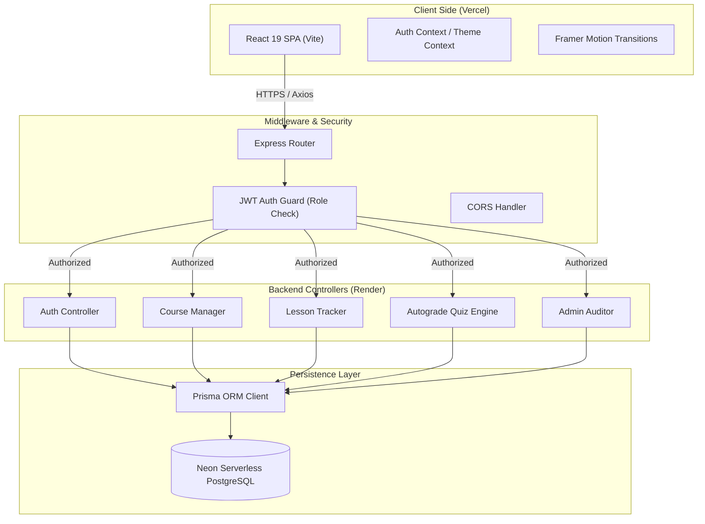

# 🎓 LearnSphere — Enterprise SaaS Learning Management System

[](https://react.dev/)
[](https://www.typescriptlang.org/)
[](https://vitejs.dev/)
[](https://tailwindcss.com/)
[](https://expressjs.com/)
[](https://www.prisma.io/)
[](https://neon.tech/)

LearnSphere is a commercial-grade, multi-tenant SaaS Learning Management System (LMS) engineered with React 19, TypeScript, Node.js/Express, and Neon Serverless PostgreSQL. It features strict role-based access control, automated curriculum trackers, dynamic SVG analytics engines, autograded quiz engines, and comprehensive administrator audit controls.

---

## 🏗️ System Architecture & Data Flow



---

## 💎 Core Architecture & Design Patterns

### 1. Frontend Architecture
- **Route-Based Code Splitting**: Implemented React `lazy()` imports and `Suspense` chunk splitting, cutting the initial bundle footprint to **425kB** and optimizing First Contentful Paint (FCP) and Largest Contentful Paint (LCP) metrics.
- **Dynamic HSL Design Tokens**: Converted the design system to use pure CSS variables under `:root` (light) and `.dark` selectors, allowing seamless, flicker-free runtime theme transitions.
- **Static Asset Exclusions**: Implemented robust `.gitignore` rules at the monorepo root to shield environment secrets, local database binaries, and `node_modules` caches.
- **SEO & Open Graph Hook**: Developed a declarative `useSEO` React hook that dynamically injects meta headers, viewport titles, and Open Graph tags for optimal indexing.

### 2. Backend API Architecture
- **Stateless Authentication**: Implemented cryptographically signed JWT credentials passed via HTTP `Authorization` headers.
- **Role-Based Guards**: Built a modular `authorize([Role])` Express middleware hierarchy restricting routes dynamically to `STUDENT`, `INSTRUCTOR`, or `ADMIN`.
- **Relational Integrity**: Designed database constraints using Prisma schemas:
  - Cascade Deletes on student logs and progress states to prevent orphaned rows.
  - Transaction-safe cascading queries to handle quiz grading and curriculum updates.
- **Interactive SVG Charts**: Developed custom SVG renderers for statistics (Earnings area curves, daily active study hours) to prevent third-party library bloat and ensure sub-second rendering.

---

## 📂 Repository Directory Tree

```
LearnSphere/
├── frontend/                     # React 19 Client SPA
│   ├── public/                   # Favicon & Vector Icons
│   ├── src/
│   │   ├── components/           # Reusable UI Elements (Card, Modal, Progress)
│   │   │   └── dashboard/        # Role-Specific Dashboards (Student, Instructor, Admin)
│   │   ├── context/              # Global React Contexts (Auth, Theme)
│   │   ├── hooks/                # Custom React Hooks (useAuth, useSEO)
│   │   ├── layouts/              # Frame Wrappers (DashboardLayout)
│   │   ├── pages/                # High-fidelity views
│   │   └── services/             # Axios Client & Interceptors
│   ├── vercel.json               # SPA routing rewrite settings
│   └── vite.config.ts            # Vite bundler configurations
└── backend/                      # Node.js/Express Server
    ├── docs/                     # OpenAPI 3.0 YAML Specs
    ├── src/
    │   ├── config/               # Process Environment Schemas
    │   ├── controllers/          # Endpoint Business Logic
    │   ├── middleware/           # Auth JWT & Role Validators
    │   ├── prisma/               # Prisma Engine Schema & DB Seeds
    │   └── routes/               # Express API endpoints
```

---

## 🛡️ Enterprise Database Seed Blueprints

Seed the database with pre-configured curriculum content:
```bash
cd backend
npm run seed
```

The database contains three pre-seeded accounts:

| Role | Email | Password | Access Privileges |
| :--- | :--- | :--- | :--- |
| **Admin** | `admin@learnsphere.com` | `Admin@123` | Moderate users, change roles, audit course proposals |
| **Instructor** | `instructor@learnsphere.com` | `Instructor@123` | Create courses, manage modules, grade assignments |
| **Student** | `student@learnsphere.com` | `Student@123` | Enroll in courses, read lessons, submit quizzes/assignments |

---

## ⚡ Deployment Playbook

### Backend (Render)
1. Set up a **Web Service** on Render.
2. Link your GitHub repository.
3. Configure the build parameters:
   - **Root Directory**: `backend`
   - **Build Command**: `npm install --production=false && npm run prisma:generate && npm run build`
   - **Start Command**: `node dist/index.js`
4. Set the following environment variables:
   - `DATABASE_URL`: *Your Neon connection string*
   - `JWT_SECRET`: *Your cryptographically secure key*
   - `NODE_ENV`: `production`

### Frontend (Vercel)
1. Create a project on Vercel.
2. Set the **Root Directory** to `frontend`.
3. Set the **Build Command** to `npm run build` and **Output Directory** to `dist`.
4. Add the environment variable:
   - `VITE_API_URL`: *Your Render Backend URL with `/api` path* (e.g. `https://api.learnsphere.com/api`).
